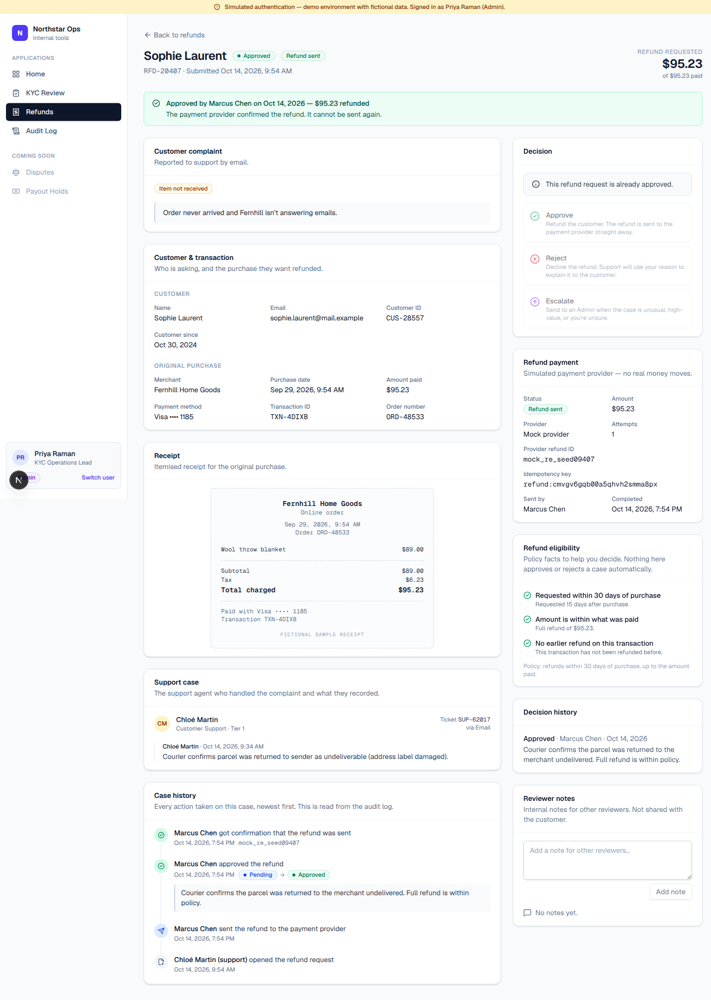
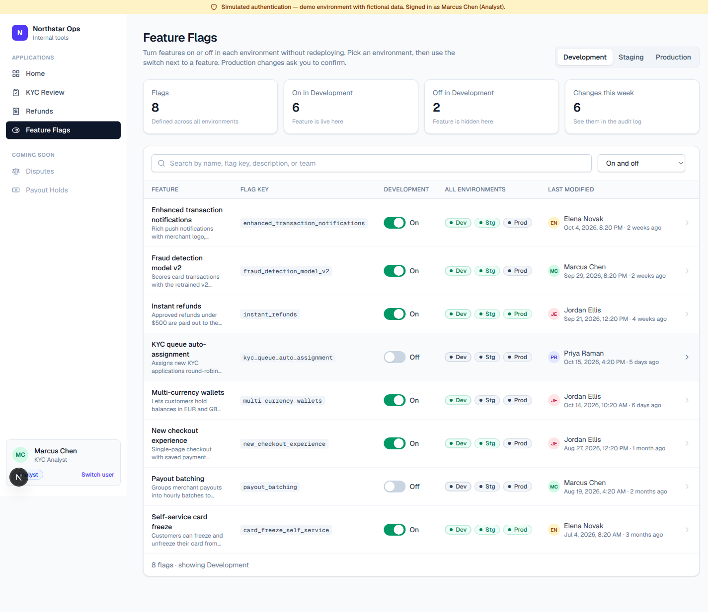

# Northstar Ops — Internal Operations Platform

A production-inspired internal tools platform for a fictional fintech. It ships three apps on shared infrastructure (navigation, design system, database patterns, role-based authorization, audit log):

- **KYC Review Queue**: reviewers open one page with the customer's profile, identity documents, history and notes, then record a human decision (Approve / Reject / Request info / Escalate) with a required explanation.
- **Refunds Dashboard**: operations staff investigate refund requests passed on by support (purchase, receipt, complaint, support notes, eligibility facts) and Approve / Reject / Escalate them. Approved refunds go to a **simulated** payment provider through an adapter, with several layers of duplicate-refund protection.
- **Feature Flags**: engineers turn features on or off per environment (Development, Staging, Production) without redeploying. Production changes need a typed confirmation and a reason. Application code reads flags with `isFeatureEnabled()` or `GET /api/flags/evaluate`.

Every action is written to a single append-only audit log.

> **Authentication is simulated.** You "sign in" by picking a demo user. There are no passwords and the session cookie is not signed. All customer data and documents are **fictional**.
>
> **All KYC decisions are human-driven.** There is no OCR, automated identity verification, or risk scoring.
>
> **No real payments.** Refunds go to a mock payment provider that never contacts a network or moves money.


## Tech stack

- **Next.js 16** (App Router, Server Components, Route Handlers) + **TypeScript**
- **Prisma 6** + **SQLite**
- **Tailwind CSS v4** with a small in-repo component library (`src/components/ui`) and `lucide-react` icons
- **Zod** for request validation
- **Vitest** for tests

## Quick start

Requirements: Node.js 20+ (tested on Node 24) and npm.

```bash
git clone https://github.com/SaketKulkarni121/cognition_interview.git
cd cognition_interview
npm install          # also runs `prisma generate`
npm run setup        # creates .env from .env.example, applies migrations, seeds fictional data
npm run dev          # http://localhost:3000
```

Open http://localhost:3000, pick a demo user, and go to **KYC Review**.

To reset the database to the original seed data at any time:

```bash
npm run db:reset     # drops prisma/dev.db, re-applies migrations, re-seeds
```

### Demo users

| User | Role | What they can do |
| --- | --- | --- |
| Priya Raman | Admin | Everything: assign any KYC reviewer, decide any open case (including escalated ones), retry failed refund payments, change production feature flags, view the audit log |
| Marcus Chen, Elena Novak, Jordan Ellis | Analyst | KYC: claim, add notes, decide applications assigned to them. Refunds: add notes, approve/reject/escalate pending cases. Flags: toggle in Development and Staging |
| Sam Okafor | Viewer | Read-only access to all three apps and the audit log |

Use **Switch user** in the sidebar to change roles.

## Using the KYC Review Queue

1. **Queue** (`/kyc`) — summary cards (New, In review, Awaiting customer, Escalated, Assigned to me), search by name/email/reference, filter by status and reviewer, sort, paginate. Each row shows customer, reference, submission date, status and assigned reviewer.
2. **Review page** (`/kyc/[id]`) — a status banner telling you what happens next, then:
   - Customer profile: personal details, contact/address, employment and account use
   - Identity documents (fictional SVG specimens) — click to enlarge and compare against the profile
   - Application history (from the audit log), previous decisions with reasons, internal reviewer notes
   - Assignment control (Admins assign anyone; Analysts claim/release)
   - Decision panel — unavailable actions are disabled with a plain-language reason; choosing an action asks for an explanation (min. 10 characters) before confirming
3. **Audit log** (`/audit`, Admin & Viewer): every submission, assignment, note and decision across all apps, with actor, timestamp, status change and reason. You can filter by app and action.

### Workflow

```
SUBMITTED ──assign──▶ IN_REVIEW ──approve──▶ APPROVED (final)
                        │  ├─reject──────▶ REJECTED (final)
                        │  ├─request info▶ INFO_REQUESTED ──info received──▶ IN_REVIEW
                        │  │                 ├─reject──▶ REJECTED
                        │  │                 └─escalate▶ ESCALATED
                        │  └─escalate────▶ ESCALATED ──(Admin only) approve / reject / request info
```

Rules enforced on the server (`src/modules/kyc/workflow.ts`, `src/modules/kyc/service.ts`):

- Only the transitions above are allowed; `APPROVED` and `REJECTED` are terminal.
- A decision requires an explanation of 10–2000 characters.
- Analysts can only act on applications assigned to them, and can only assign/release themselves.
- Escalated applications can only be decided by an Admin.
- Viewers cannot assign, add notes, or decide.
- Assigning a `SUBMITTED` application moves it to `IN_REVIEW` automatically.
- Each mutation runs in a transaction together with its audit-log entry, and checks the status the reviewer was looking at (`expectedStatus`) to reject stale/concurrent updates with `409`.

## Refunds Dashboard



1. **Dashboard** (`/refunds`): cards for pending requests, total amount requested (and how much is still open), approved (with the amount refunded), rejected, and escalated. Below them is a table you can search by customer, email, case `RFD-…`, transaction `TXN-…` or merchant, filter by status and reason, sort by date or amount, and page through.
2. **Case page** (`/refunds/[id]`):
   - Customer complaint and reason category
   - Customer and transaction details (merchant, purchase date, amount, payment method)
   - Itemised receipt
   - Support case: the agent who handled it, the ticket, the channel, and the agent's notes
   - Case history from the audit log
   - Decision panel: Approve, Reject or Escalate, each with a required explanation of at least 10 characters. Approving shows exactly what will be refunded and to which card before you confirm.
   - Refund payment card: provider status, provider refund ID, idempotency key, attempts and last error, plus a **Retry** button for Admins when a payment failed
   - Refund eligibility: whether the request is within the 30-day window, whether the amount is within what's still refundable, and whether the purchase was refunded before. These are informational only and never decide anything.
   - Decision history and reviewer notes

### Refund workflow

```
PENDING ──approve──▶ APPROVED (final) ──▶ payout: PROCESSING → SUCCEEDED | FAILED ─(Admin retry)─▶ SUCCEEDED
   │  ├──reject───▶ REJECTED (final, no payout)
   │  └─escalate──▶ ESCALATED ──(Admin only) approve / reject
```

These rules are enforced on the server (`src/modules/refunds/workflow.ts`, `src/modules/refunds/service.ts`):

- Analysts and Admins decide pending cases. Only Admins decide escalated cases. Viewers can't decide or add notes.
- Approval runs in one database transaction: a conditional status update, the decision, the audit entry, and a `RefundPayout` row. The refund is then sent to the provider and the result is recorded and audited.

#### Duplicate-refund protection

- **State machine:** `APPROVED` is final, so a second approve returns `409`.
- **Conditional update:** `updateMany where status = current`. Only one of two concurrent approvals can change the status. The other gets `409`, and the provider is never called for it.
- **Database constraints:** `RefundPayout.caseId` and `RefundPayout.idempotencyKey` are both `@unique`. A second payout row for the same case can't exist.
- **Idempotency key:** `refund:<caseId>` goes to the provider on every attempt, including retries. A real provider would return the original refund instead of creating a new one, and the mock does the same.
- **Retry claim:** a retry first claims the payout atomically (`FAILED → PROCESSING`). Retrying a payout that succeeded or is in flight returns `409`.

### Payment provider adapter

`src/lib/payments/types.ts` defines `PaymentProvider.createRefund({ idempotencyKey, amount, currency, transactionReference })`. `getPaymentProvider()` (`src/lib/payments/index.ts`) picks the implementation from `PAYMENT_PROVIDER`. The default, and the only option today, is `mock` (`MockPaymentProvider`). It validates the amount, honours idempotency keys, adds a small delay, and returns a `mock_re_…` ID. To connect a real provider, implement the interface and add a case to `getPaymentProvider()`. Business logic doesn't change.

Seed data: 17 fictional cases. 7 pending (one outside the 30-day window, one a second refund on an already partly refunded purchase), 3 escalated, 4 approved (one with a **failed** payout, so you can try the Admin retry), and 3 rejected.

## Feature Flags



1. **List** (`/flags`):
   - Pick Development, Staging or Production at the top right.
   - Cards show the total number of flags, how many are on and off in the selected environment, and how many changes were made this week.
   - You can search by name, key, description or team, and filter to flags that are on or off.
   - Each row shows the feature name and description, the unique flag key, a switch for the selected environment, on/off dots for all three environments, and who last changed the flag and when.
2. **Flag page** (`/flags/[key]`):
   - One card per environment, each with its own switch, version and last-modified info. If you can't change an environment, it says why.
   - The change history, read from the audit log.
   - A "Using this flag in code" snippet.

Rules, enforced on the server (`src/modules/flags/workflow.ts`, `service.ts`):

- **Who can change what.** Viewers are read-only. Analysts can change Development and Staging. Only Admins can change Production.
- **Production confirmation.** In the UI, Production changes open a dialog where you type the flag key and a reason. The server rejects a production change unless `confirmation === key` and the reason is at least 10 characters.
- **Invalid configurations.**
  - The environment must be one of the three.
  - `enabled` must be a boolean.
  - Unknown flags return `404`.
  - Setting a flag to the state it's already in is rejected.
  - A flag can't be turned on in Production unless it's on in Staging. Turning Production *off* is always allowed, so it works as a kill switch.
- **Concurrency.** Each environment config has a `version`. The UI sends `expectedVersion`, and stale changes get `409`.
- **Audit.** Every change writes `flags.flag.enabled` or `flags.flag.disabled` to the shared audit log, with the actor, a timestamp, Off→On, the reason, and the environment.

Evaluation is deliberately simple: one boolean per flag per environment. There are no percentage rollouts, targeting, or experiments.

```ts
import { isFeatureEnabled } from "@/lib/feature-flags";
if (await isFeatureEnabled("new_checkout_experience")) { /* new flow */ }   // env from APP_ENV, default DEVELOPMENT
```

`GET /api/examples/checkout?env=STAGING` is a sample endpoint. It picks the "new" or "classic" checkout flow based on `new_checkout_experience`.

Seed data: 8 fictional flags, including **Instant refunds**, **Fraud detection model v2**, **New checkout experience** (recently switched off in Production with a kill-switch reason) and **Enhanced transaction notifications**. Each has per-environment states and a change history.

## Deploying to Vercel (demo)

Vercel runs the `vercel-build` script. It applies the migrations to a fresh SQLite file (`prisma/dev.db`), seeds the fictional data, and builds the app. `next.config.ts` (`outputFileTracingIncludes`) bundles the seeded file with every server function, and on a cold start `src/lib/db.ts` copies it to `/tmp`, the only writable path on Vercel. You don't need to set `DATABASE_URL`.

This is for demos only. Each serverless instance has its own copy of the data, so changes are not shared between instances and are lost when an instance restarts. A real deployment needs a hosted database such as Postgres (Neon, Vercel Postgres, …).

## API

All endpoints require a (simulated) session cookie and return JSON errors as `{ "error": { "code", "message", "details?" } }` with `401` / `403` / `404` / `400` / `409` status codes.

| Method & path | Description | Allowed roles |
| --- | --- | --- |
| `GET /api/kyc/applications?q=&status=&reviewer=&sort=&page=` | List/search applications | All |
| `GET /api/kyc/applications/:id` | Full application with documents, notes, decisions, history | All |
| `POST /api/kyc/applications/:id/assign` `{ reviewerId: string \| null }` | Assign, claim or release | Admin (anyone), Analyst (self) |
| `POST /api/kyc/applications/:id/decisions` `{ action, reason, expectedStatus? }` | `APPROVE`, `REJECT`, `REQUEST_INFO`, `ESCALATE`, `RESUME_REVIEW` | Admin, assigned Analyst |
| `POST /api/kyc/applications/:id/notes` `{ body }` | Add an internal note | Admin, Analyst |
| `GET /api/kyc/reviewers` | Users who can be assigned | All |
| `GET /api/kyc/documents/:id/image` | Fictional document image (SVG) | All |
| `GET /api/refunds/cases?q=&status=&reason=&sort=&page=` | List/search refund cases (`status`: `PENDING`, `ESCALATED`, `APPROVED`, `REJECTED`, `OPEN`, `ALL`; `sort`: `newest`, `oldest`, `amount`) | All |
| `GET /api/refunds/cases/:id` | Case with transaction, notes, decisions, payout, history, eligibility | All |
| `POST /api/refunds/cases/:id/decisions` `{ action, reason, expectedStatus? }` | `APPROVE` (also sends the refund), `REJECT`, `ESCALATE` | Admin, Analyst (pending cases only) |
| `POST /api/refunds/cases/:id/notes` `{ body }` | Add a reviewer note | Admin, Analyst |
| `POST /api/refunds/cases/:id/payment/retry` | Retry a `FAILED` payout with the same idempotency key | Admin |
| `GET /api/refunds/stats` | Dashboard totals | All |
| `GET /api/flags?q=&env=&state=on\|off` | List flags with every environment's config | All |
| `GET /api/flags/:key` | Flag, environment configs, change history | All |
| `POST /api/flags/:key/environments/:env` `{ enabled, expectedVersion?, reason?, confirmation? }` | Turn a flag on or off in one environment (`PRODUCTION` needs `confirmation` = key and a reason) | Admin (all), Analyst (Dev/Staging) |
| `GET /api/flags/evaluate?env=&keys=a,b` | Flag values for application code; unknown keys return `false` | All signed-in |
| `GET /api/examples/checkout?env=` | Sample endpoint showing a flag in use | All signed-in |
| `GET /api/audit-log?module=&action=&q=&page=` | Audit log | Admin, Viewer |
| `GET / POST / DELETE /api/session` | Current user / sign in as a demo user / sign out | — |

Example (after signing in as Marcus Chen in the browser, or with a cookie jar):

```bash
curl -b cookies.txt -X POST localhost:3000/api/kyc/applications/<id>/decisions \
  -H 'content-type: application/json' \
  -d '{"action":"APPROVE","reason":"Passport and utility bill match the profile."}'
```

## Architecture

```
prisma/
  schema.prisma          User, AuditLog, Kyc* models, PaymentTransaction, RefundCase/Note/Decision/Payout
  seed.ts                Users + 22 fictional KYC applications with history
  seed-refunds.ts        17 fictional refund cases, transactions, support notes, decisions, payouts
  seed-flags.ts          8 fictional feature flags with per-environment states and history
src/
  config/apps.ts         Registry of internal apps → drives the sidebar and home page
  lib/
    auth/permissions.ts  Role → permission map, can()/assertCan()
    auth/session.ts      Simulated session (cookie holding a user id)
    api.ts               apiHandler(): auth, Zod parsing, consistent error responses
    audit.ts             recordAudit()/listAuditLog() — shared, module-agnostic audit log
    errors.ts            Typed errors mapped to HTTP status codes
    validation.ts        Shared decision-reason / note schemas, parseInput()
    payments/            PaymentProvider adapter interface + MockPaymentProvider
    feature-flags.ts     isFeatureEnabled() for application code
    api-client.ts        Browser fetch helper for the JSON APIs
    db.ts                Prisma client singleton
  modules/kyc/
    workflow.ts          Pure state machine + rules (shared by UI and server)
    service.ts           Data access + authorization + transactions + audit writes
    schemas.ts           Zod request schemas
    documents.ts         Fictional SVG document renderer
  modules/refunds/       workflow.ts (state machine + eligibility facts), service.ts, schemas.ts
  modules/flags/         workflow.ts (environments, who-can-change, config rules), service.ts, schemas.ts
  components/ui/         Button, Badge, Card, Table, Form fields, Dialog, Alert, Avatar,
                         StatCard, DetailSection/DetailField, Pagination, Switch, SegmentedLinks
  components/workflow/   Shared across apps: FilterBar (URL-synced search/filters), DecisionPanel
                         (action + required reason), NotesPanel, ModuleStatusBadge
  components/audit/      Audit event registry (labels/icons for every app) + HistoryTimeline
  components/shell/      App shell, sidebar, simulated-auth banner
  components/kyc/        KYC-specific: assignment, documents, thin wrappers over shared components
  components/refunds/    Refund-specific: filters, receipt, retry-payment button
  components/flags/      FlagToggle (with production confirmation dialog), filters
  app/(platform)/        Authenticated pages: home, /kyc, /kyc/[id], /refunds, /refunds/[id], /flags, /flags/[key], /audit
  app/api/               Route handlers (thin: parse → call service → JSON)
```

**Adding another internal app** (e.g. Disputes, already shown as "coming soon"). Refunds was built exactly this way:

1. Add Prisma models.
2. Create `src/modules/<app>/` with a workflow and a service that call `assertCan()` and `recordAudit({ module: "<app>", … })`.
3. Add permissions in `permissions.ts`.
4. Register the app's statuses in `components/workflow/status-badge.tsx` and its audit events in `components/audit/events.ts`.
5. Add pages under `src/app/(platform)/<app>` built from `FilterBar`, `StatCard`, `DecisionPanel`, `NotesPanel` and `HistoryTimeline`.
6. Add an entry to `src/config/apps.ts`.

## Tests

```bash
npm test             # Vitest — uses an isolated prisma/test.db, reset per run
npm run lint
npm run typecheck
npm run build
```

Test suites (`tests/`):

- `permissions.test.ts` — role → permission matrix
- `workflow.test.ts` — allowed/blocked transitions, terminal states, required reasons, assignment rules, Admin-only escalated decisions
- `kyc-service.test.ts` — against a real SQLite DB: claim → approve with audit entries; request info → resume → escalate → Admin reject; missing reason; invalid and stale transitions; Viewer and cross-Analyst restrictions; Admin reassignment; notes audited
- `refunds.test.ts`, run against a real SQLite DB with a spy payment provider:
  - Permissions matrix, state-machine transitions, and eligibility facts
  - Approving sends exactly one refund and writes three audit entries
  - A second approve is blocked and the provider is called only once
  - Of two concurrent approvals, only one succeeds
  - The database rejects a second payout for the same case
  - A failed payout can be retried by an Admin only, reuses the same idempotency key, and returns `409` once it has succeeded
  - The mock provider is idempotent
  - Rejection needs a reason and never contacts the provider
  - Escalated cases can only be decided by an Admin
  - Viewers are blocked, and stale updates are detected
  - Notes are audited and the dashboard totals are correct
- `flags.test.ts`:
  - Permissions matrix and server-side blocks for Viewers, and for Analysts in Production
  - Toggling bumps the version and writes an audit entry
  - Production needs the typed key and a reason
  - Invalid configurations are rejected: already in that state, Production before Staging, unknown environment, a non-boolean value, unknown flag
  - Stale versions get `409`
  - Turning Production off is always allowed
  - Evaluation, including unknown flags returning `false`, and list filters

## Limitations

- **Simulated authentication** — unsigned cookie, no passwords, no SSO. Replace `src/lib/auth/session.ts` with a real identity provider before any real use.
- **No document upload or customer-facing flow** — documents are generated fictional SVGs; "Info received" is recorded manually by a reviewer.
- **No OCR, identity verification, sanctions screening or risk scoring** — by design; decisions are entirely human.
- **SQLite** is single-writer and file-based; fine for a demo, use Postgres for production (Prisma makes this a datasource change). Enum-like fields are stored as strings because SQLite has no native enums; values are validated in code.
- Audit log is append-only by convention (no update/delete code paths), not enforced at the database level.
- No real-time updates — concurrent edits are caught with a `409` and the reviewer is asked to refresh.
- Tests cover domain logic, authorization and the service layer; there are no automated browser (E2E) tests.
- **Refunds:**
  - The payment provider is a mock. No refund is sent anywhere, and its idempotency memory lasts only for the life of the server process. The database constraints are the durable guard.
  - Refund requests arrive through seed data only; there is no intake form or support-tool integration.
  - If the server crashes after a payout is claimed (`PROCESSING`) but before the provider answers, the payout stays `PROCESSING`. A real system would reconcile with the provider using the idempotency key; this demo has no reconciliation job.
  - Eligibility checks cover a single 30-day, up-to-amount-paid policy and are informational only. There are no approval limits by amount.
- **Feature flags:**
  - Flags are read from SQLite on every check, with no cache, SDK, or push updates. A distributed service would need caching and invalidation.
  - The evaluate API uses the simulated user session; real services would need service-to-service credentials.
  - Flags are created through seed data only, with no create, archive or delete UI.
  - There are no percentage rollouts, targeting or scheduled changes, by design.
