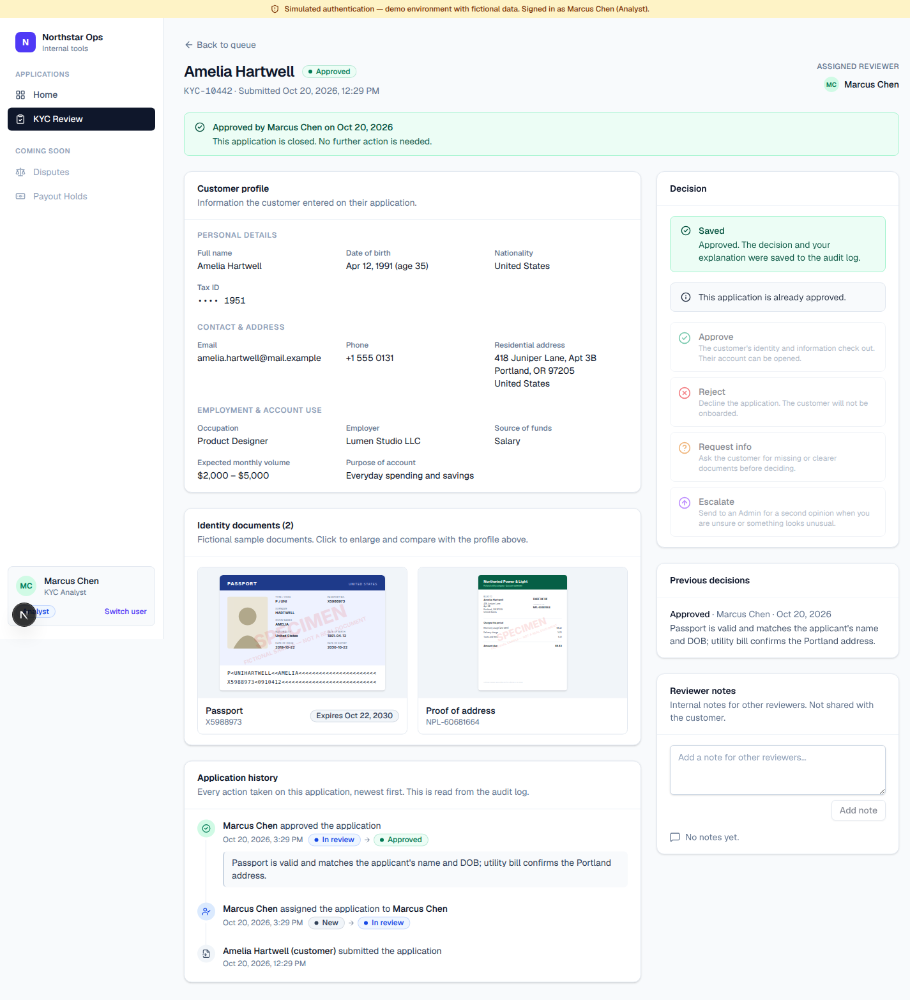

# Northstar Ops — Internal Operations Platform

A production-inspired internal tools platform for a fictional fintech, starting with a **KYC Review Queue**. Reviewers see every application in one queue, open a single page with the customer's profile, identity documents, history and notes, and record a human decision (Approve / Reject / Request info / Escalate) with a required explanation. Every action is written to an append-only audit log.

> **Authentication is simulated.** You "sign in" by picking a demo user. There are no passwords and the session cookie is not signed. All customer data and documents are **fictional**.
>
> **All KYC decisions are human-driven.** There is no OCR, automated identity verification, or risk scoring.



## Tech stack

- **Next.js 16** (App Router, Server Components, Route Handlers) + **TypeScript**
- **Prisma 6** + **SQLite**
- **Tailwind CSS v4** with a small in-repo component library (`src/components/ui`) and `lucide-react` icons
- **Zod** for request validation
- **Vitest** for tests

## Quick start

Requirements: Node.js 20+ (tested on Node 24) and npm.

```bash
git clone https://github.com/SaketKulkarni121/cognition_interview.git
cd cognition_interview
npm install          # also runs `prisma generate`
npm run setup        # creates .env from .env.example, applies migrations, seeds fictional data
npm run dev          # http://localhost:3000
```

Open http://localhost:3000, pick a demo user, and go to **KYC Review**.

To reset the database to the original seed data at any time:

```bash
npm run db:reset     # drops prisma/dev.db, re-applies migrations, re-seeds
```

### Demo users

| User | Role | What they can do |
| --- | --- | --- |
| Priya Raman | Admin | Everything: assign any reviewer, decide any open application (including escalated ones), view the audit log |
| Marcus Chen, Elena Novak, Jordan Ellis | Analyst | Claim unassigned applications, add notes, decide applications assigned to them, escalate to an Admin |
| Sam Okafor | Viewer | Read-only access to applications and the audit log |

Use **Switch user** in the sidebar to change roles.

## Using the KYC Review Queue

1. **Queue** (`/kyc`) — summary cards (New, In review, Awaiting customer, Escalated, Assigned to me), search by name/email/reference, filter by status and reviewer, sort, paginate. Each row shows customer, reference, submission date, status and assigned reviewer.
2. **Review page** (`/kyc/[id]`) — a status banner telling you what happens next, then:
   - Customer profile: personal details, contact/address, employment and account use
   - Identity documents (fictional SVG specimens) — click to enlarge and compare against the profile
   - Application history (from the audit log), previous decisions with reasons, internal reviewer notes
   - Assignment control (Admins assign anyone; Analysts claim/release)
   - Decision panel — unavailable actions are disabled with a plain-language reason; choosing an action asks for an explanation (min. 10 characters) before confirming
3. **Audit log** (`/audit`, Admin & Viewer) — every submission, assignment, note and decision with actor, timestamp, status change and reason.

### Workflow

```
SUBMITTED ──assign──▶ IN_REVIEW ──approve──▶ APPROVED (final)
                        │  ├─reject──────▶ REJECTED (final)
                        │  ├─request info▶ INFO_REQUESTED ──info received──▶ IN_REVIEW
                        │  │                 ├─reject──▶ REJECTED
                        │  │                 └─escalate▶ ESCALATED
                        │  └─escalate────▶ ESCALATED ──(Admin only) approve / reject / request info
```

Rules enforced on the server (`src/modules/kyc/workflow.ts`, `src/modules/kyc/service.ts`):

- Only the transitions above are allowed; `APPROVED` and `REJECTED` are terminal.
- A decision requires an explanation of 10–2000 characters.
- Analysts can only act on applications assigned to them, and can only assign/release themselves.
- Escalated applications can only be decided by an Admin.
- Viewers cannot assign, add notes, or decide.
- Assigning a `SUBMITTED` application moves it to `IN_REVIEW` automatically.
- Each mutation runs in a transaction together with its audit-log entry, and checks the status the reviewer was looking at (`expectedStatus`) to reject stale/concurrent updates with `409`.

## API

All endpoints require a (simulated) session cookie and return JSON errors as `{ "error": { "code", "message", "details?" } }` with `401` / `403` / `404` / `400` / `409` status codes.

| Method & path | Description | Allowed roles |
| --- | --- | --- |
| `GET /api/kyc/applications?q=&status=&reviewer=&sort=&page=` | List/search applications | All |
| `GET /api/kyc/applications/:id` | Full application with documents, notes, decisions, history | All |
| `POST /api/kyc/applications/:id/assign` `{ reviewerId: string \| null }` | Assign, claim or release | Admin (anyone), Analyst (self) |
| `POST /api/kyc/applications/:id/decisions` `{ action, reason, expectedStatus? }` | `APPROVE`, `REJECT`, `REQUEST_INFO`, `ESCALATE`, `RESUME_REVIEW` | Admin, assigned Analyst |
| `POST /api/kyc/applications/:id/notes` `{ body }` | Add an internal note | Admin, Analyst |
| `GET /api/kyc/reviewers` | Users who can be assigned | All |
| `GET /api/kyc/documents/:id/image` | Fictional document image (SVG) | All |
| `GET /api/audit-log?module=&action=&q=&page=` | Audit log | Admin, Viewer |
| `GET / POST / DELETE /api/session` | Current user / sign in as a demo user / sign out | — |

Example (after signing in as Marcus Chen in the browser, or with a cookie jar):

```bash
curl -b cookies.txt -X POST localhost:3000/api/kyc/applications/<id>/decisions \
  -H 'content-type: application/json' \
  -d '{"action":"APPROVE","reason":"Passport and utility bill match the profile."}'
```

## Architecture

```
prisma/
  schema.prisma          User, KycApplication, KycDocument, KycNote, KycDecision, AuditLog
  seed.ts                22 fictional applications across every status, with history
src/
  config/apps.ts         Registry of internal apps → drives the sidebar and home page
  lib/
    auth/permissions.ts  Role → permission map, can()/assertCan()
    auth/session.ts      Simulated session (cookie holding a user id)
    api.ts               apiHandler(): auth, Zod parsing, consistent error responses
    audit.ts             recordAudit()/listAuditLog() — shared, module-agnostic audit log
    errors.ts            Typed errors mapped to HTTP status codes
    db.ts                Prisma client singleton
  modules/kyc/
    workflow.ts          Pure state machine + rules (shared by UI and server)
    service.ts           Data access + authorization + transactions + audit writes
    schemas.ts           Zod request schemas
    documents.ts         Fictional SVG document renderer
  components/ui/         Button, Badge, Card, Table, Form fields, Dialog, Alert, Avatar, …
  components/shell/      App shell, sidebar, simulated-auth banner
  components/kyc/        Queue filters, decision panel, notes, documents, history
  app/(platform)/        Authenticated pages: home, /kyc, /kyc/[id], /audit
  app/api/               Route handlers (thin: parse → call service → JSON)
```

**Adding another internal app** (e.g. Disputes, already shown as "coming soon"): add a Prisma model, create `src/modules/<app>/` with a workflow + service that call `assertCan()` and `recordAudit({ module: "<app>", … })`, add permissions in `permissions.ts`, add pages under `src/app/(platform)/<app>`, and flip its entry in `src/config/apps.ts` to live. The shell, UI components, API helper, and audit log are reused as-is.

## Tests

```bash
npm test             # Vitest — uses an isolated prisma/test.db, reset per run
npm run lint
npm run typecheck
npm run build
```

Test suites (`tests/`):

- `permissions.test.ts` — role → permission matrix
- `workflow.test.ts` — allowed/blocked transitions, terminal states, required reasons, assignment rules, Admin-only escalated decisions
- `kyc-service.test.ts` — against a real SQLite DB: claim → approve with audit entries; request info → resume → escalate → Admin reject; missing reason; invalid and stale transitions; Viewer and cross-Analyst restrictions; Admin reassignment; notes audited

## Limitations

- **Simulated authentication** — unsigned cookie, no passwords, no SSO. Replace `src/lib/auth/session.ts` with a real identity provider before any real use.
- **No document upload or customer-facing flow** — documents are generated fictional SVGs; "Info received" is recorded manually by a reviewer.
- **No OCR, identity verification, sanctions screening or risk scoring** — by design; decisions are entirely human.
- **SQLite** is single-writer and file-based; fine for a demo, use Postgres for production (Prisma makes this a datasource change). Enum-like fields are stored as strings because SQLite has no native enums; values are validated in code.
- Audit log is append-only by convention (no update/delete code paths), not enforced at the database level.
- No real-time updates — concurrent edits are caught with a `409` and the reviewer is asked to refresh.
- Tests cover domain logic, authorization and the service layer; there are no automated browser (E2E) tests.
